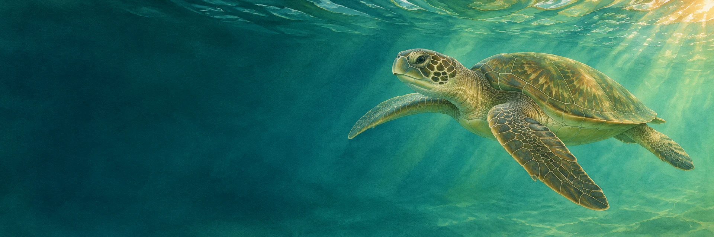

# Turtle Rescue



Иллюстрированный квест на британском английском для уровня A2–A2+. После шторма волонтёры едут в Пеббл-Бей очищать пляж, на котором морские черепахи откладывают яйца.

## Как играть

Начните квест и помогите Мии и Лео пройти семь эпизодов. Открывайте объявления и локации прямо в сцене, отвечайте героям, выбирайте маршрут и читайте дорожные знаки. После того как у автобуса лопнет шина, заберите перчатки и мешки в Pine Café и найдите путь к центру пешком. На пляже выберите, какой мусор можно собрать и о каком нужно сообщить рейнджеру. Финальная сцена откроется после уборки.

Кнопка **Teacher key** открывает ответы и подсказки для устной работы. **Notice** открывает объявление, **Pause motion** выключает анимацию. Прогресс этого приключения сохраняется в текущем браузере.

## Запуск

Это статический сайт. Для локального запуска поднимите сервер в корне репозитория.

```sh
python3 -m http.server 8000
```

Затем откройте [игру в браузере](http://localhost:8000). Для GitHub Pages источник публикации — ветка `main`, папка `/(root)`.

## Файлы

- `quest.js` — текст, задания, ответы и подсказки.
- `game.js` — игровой интерфейс и прогресс.
- `styles.css` — оформление и дорожные знаки.
- `assets/` — иллюстрации, аватары и шрифты.
